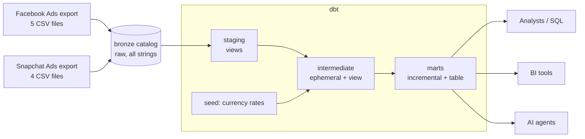

# Marketing Data Platform

A marketing data platform that loads Facebook Ads and Snapchat Ads data into **Databricks**, transforms it with **dbt** into one tested and documented model of spend, impressions and clicks, and monitors it with **Elementary**. Separate dev, CI and production environments, service principal authentication for automation, Unity Catalog permissions and GitHub Actions CI/CD.

Marketers no longer need to open each ad platform: one governed table answers *"how much did we spend on Facebook vs Snapchat?"*, *"which campaign got the most clicks?"* or *"what is our CPC?"* in SQL, a BI tool or through an AI agent.

---

## Architecture



| Layer | Where | Purpose |
|---|---|---|
| Raw | `bronze.facebook_ads`, `bronze.snapchat_ads` | Files uploaded unchanged. All columns stored as strings so nothing (e.g. 18-digit IDs) is lost on load. |
| Transformation | dbt `staging` + `intermediate` | Rename, type, clean, deduplicate, join, unify. |
| Analytical | dbt `marts` | The data product: `fct_marketing_spend`, `fct_campaign_performance_daily`. |
| Consumption | `production.marts` | Queried by analysts, BI and AI agents. |

### Lineage

```
facebook_ads sources ─► stg_facebook_ads__* ─► int_facebook_ads__daily ─┐
                                                                       ├─► int_marketing_ads ─► fct_marketing_spend ─► fct_campaign_performance_daily
snapchat_ads sources ─► stg_snapchat_ads__* ─► int_snapchat_ads__daily ─┘          ▲
                                                     seed: currency_rates_to_eur ──┘
```

---

## Source data and how platform differences were handled

The data was profiled before modelling. Findings and decisions:

| Finding | Decision |
|---|---|
| Different column names (Snapchat `ad_detail_id` vs Facebook `ad_id`, etc.) | Renamed in staging to one vocabulary: `date_day, platform, campaign_id, ad_group_id, ad_id, spend, impressions, clicks…` |
| Facebook stats: one row per ad per day. Snapchat stats: one row per ad per day **per country** | Snapchat summed across countries in `int_snapchat_ads__daily` so both platforms share the same grain. |
| **Two currencies**: Facebook accounts report in USD or EUR; Snapchat in EUR | Keep original `spend` + `currency_code`, and add `spend_eur` using a seed of rates. Never sum `spend` across currencies. |
| Snapchat ad group table is a history table (some ad groups appear twice) | Staging keeps the latest version per ad group (`qualify row_number()`). |
| Facebook has null clicks (24k rows) / impressions (1.5k rows) | Treated as 0 (no activity recorded). Documented in the model. |
| Facebook IDs are 18 digits | All IDs kept as `string`: safe from rounding, and Snapchat IDs are UUIDs anyway. |
| Snapchat spend is in normal units (not micro-currency) | No conversion needed. |
| Snapchat has no account names | `account_name` is null for Snapchat. |
| 85 Snapchat ads point to ad groups missing from the export | None of them have stats; joins are `left join` so no stats rows are ever dropped (checked by a reconciliation test). |
| Facebook data covers 2025, Snapchat 2024 | Periods don't overlap in this sample; cross-platform comparisons are over all time. |

---

## Models

| Model | Grain | Materialization | Why |
|---|---|---|---|
| `stg_facebook_ads__*` (5), `stg_snapchat_ads__*` (4) | 1:1 with the raw table (Snapchat ad groups deduplicated) | **view** | Light, 1:1 logic. Views cost no storage and are always in sync with raw. |
| `int_facebook_ads__daily`, `int_snapchat_ads__daily` | ad × day | **ephemeral** | Used by one model only; inlined as a CTE so nothing extra is stored or exposed. |
| `int_marketing_ads` | platform × ad × day | **view** | Reusable unified shape; read only by the marts, so no need to store it. |
| `fct_marketing_spend` | **one row per platform, per ad, per day** | **incremental (merge)** | Largest table and grows daily; ad platforms only add new days or restate recent ones. Each run reprocesses only the last 3 days *per platform* (platforms load on different schedules) and merges on the key. |
| `fct_campaign_performance_daily` | **one row per platform, per campaign, per day** | **table** | Small, pre-aggregated, queried often by BI/AI; holds CTR/CPC/CPM. |
| seed `currency_rates_to_eur` | one row per currency | seed | Small static reference data, versioned in git. |

**Why a wide fact table instead of a star schema?** The dimensions (campaign, ad group, ad, account) are small and only used to label the facts. One wide, well-documented table is easier for non-technical users and AI agents to query correctly (no joins to get wrong). Separate dimension tables are a natural next step if other facts (e.g. conversions) are added.

**Keys:** `marketing_spend_id` = surrogate key of `platform + ad_id + date_day` (an ad ID is only unique within a platform). `campaign_performance_id` = `platform + campaign_id + date_day + currency_code`.

### Business metrics
| Metric | Definition | Zero handling |
|---|---|---|
| CTR | clicks / impressions | null when impressions = 0 |
| CPC | spend_eur / clicks | null when clicks = 0 |
| CPM | spend_eur / impressions × 1000 | null when impressions = 0 |

Ratios are calculated **after** summing. For any other period, re-calculate from summed metrics. Never average ratios.

---

## Data quality

| Test | Protects against |
|---|---|
| `unique` + `not_null` on every primary key; `unique_combination_of_columns` on stats grain | Duplicate rows inflating spend |
| `relationships` (stats → ads → ad groups → campaigns, stats → accounts) | Orphan records / broken joins |
| `accepted_values` on `platform`, `currency_code`, `ad_status` | Unexpected values breaking filters and the EUR conversion |
| `accepted_range >= 0` on spend, impressions, clicks; CTR between 0 and 1 | Impossible metric values |
| `not_null` on `spend_eur` | A new currency arriving without a rate |
| Singular: `assert_clicks_not_greater_than_impressions` | Corrupt source metrics |
| Singular: `assert_spend_reconciles_to_source` | Rows lost or duplicated by joins, dedup or incremental logic: total spend per platform must equal raw |
| Singular: `assert_metrics_in_fact_match_campaign_mart` | Aggregation errors between the two marts |
| Elementary `volume_anomalies`, `schema_changes` (warn) | Unexpected drops/spikes in row counts; columns changing upstream |

## Observability (Elementary)
The Elementary dbt package stores every run and test result in an `elementary` schema. The production workflow generates the Elementary HTML report (test results, failed tests, model health, history, anomalies) and uploads it with the static dbt docs as a workflow artifact.

---

## Environments

| | Dev | CI | Production |
|---|---|---|---|
| Who runs it | Developer, locally | GitHub Actions, on each pull request | GitHub Actions, on merge to `main` + daily |
| dbt target | `dev` | `ci` | `prod` |
| Catalog | `development` | `ci_development` | `production` |
| Schemas | `dbt_<name>_staging / _intermediate / _marts` | `pr_<number>_staging / …` (one per PR) | `staging`, `intermediate`, `marts`, `elementary` |
| Authentication | Personal access token | **Service principal** (OAuth) | **Service principal** (OAuth) |

Schema routing is done by `macros/generate_schema_name.sql`. Raw data lives in `bronze` and is shared read-only by all environments.

## Security

- **Production never uses a personal token.** CI and prod authenticate as a Databricks **service principal** with OAuth machine-to-machine (`client_id` + `client_secret`), so deployments don't depend on any person's account.
- **No secrets in git.** `profiles.yml` only references environment variables; secrets live in GitHub → Settings → Secrets.
- **Least privilege** (`databricks/01_setup_catalogs_and_grants.sql`): the service principal can only *read* `bronze` and *build* in `ci_development` / `production`; it cannot touch `development`. The developer can read CI and production results but only builds in `development`.

## CI/CD

```
feature branch ─► pull request ─► CI (dbt build + tests + docs in pr_<n> schema) ─► review & merge ─► Deploy to Production (dbt build + docs + Elementary report)
```

- **`ci.yml`** (pull request): installs dbt, `dbt debug` as the service principal, `dbt build --full-refresh` (builds and tests every model in an isolated `pr_<n>` schema), `dbt docs generate --static`. A failing test blocks the merge.
- **`deploy_prod.yml`** (push to `main`, daily 06:00 UTC, manual): `dbt build` against production (incremental), static docs, Elementary report, uploaded as artifacts. Runs never overlap.

The whole project is built in CI rather than only changed models ("slim CI") because the project is small; slim CI with `state:modified` is the upgrade path as it grows.

---

## Setup

**Prerequisites:** Python 3.11, a Databricks workspace, a GitHub repo.

1. **Load raw data.** In Databricks, run steps 1 of `databricks/01_setup_catalogs_and_grants.sql`, create schemas `bronze.facebook_ads` and `bronze.snapchat_ads`, then upload each CSV (Add data → Create or modify table) with *automatic column type detection off*, keeping the file name as table name.
2. **Service principal.** Settings → Identity and access → Service principals → Add. Give it *Databricks SQL access*, generate an OAuth secret, and grant it **Can use** on the SQL warehouse. Fill in the placeholders and run the rest of the grants script.
3. **Local dev.**
   ```powershell
   python -m venv .venv; .venv\Scripts\activate
   pip install -r requirements.txt
   cd marketing_dbt
   $env:DATABRICKS_HOST="<workspace host, no https://>"
   $env:DATABRICKS_HTTP_PATH="<SQL warehouse HTTP path>"
   $env:DATABRICKS_TOKEN="<personal access token>"
   dbt deps; dbt debug; dbt build
   dbt docs generate --static        # -> target/static_index.html
   edr report --profiles-dir .       # -> edr_target/elementary_report.html
   ```
4. **GitHub secrets** (Settings → Secrets and variables → Actions): `DATABRICKS_HOST`, `DATABRICKS_HTTP_PATH`, `DATABRICKS_CLIENT_ID`, `DATABRICKS_CLIENT_SECRET`. Create an environment named `production`.

---

## Example questions

```sql
-- Spend by platform (EUR)
select platform, sum(spend_eur) as spend_eur
from production.marts.fct_marketing_spend group by platform;

-- Top 10 campaigns by clicks
select platform, campaign_name, sum(clicks) as clicks, sum(impressions) as impressions
from production.marts.fct_campaign_performance_daily
group by platform, campaign_name order by clicks desc limit 10;

-- CTR, CPC, CPM by platform (ratios recalculated from totals)
select platform,
       sum(clicks) / nullif(sum(impressions), 0)          as ctr,
       sum(spend_eur) / nullif(sum(clicks), 0)            as cpc_eur,
       sum(spend_eur) / nullif(sum(impressions), 0) * 1000 as cpm_eur
from production.marts.fct_campaign_performance_daily group by platform;

-- Monthly trend
select date_trunc('month', date_day) as month, platform, sum(spend_eur) as spend_eur, sum(clicks) as clicks
from production.marts.fct_marketing_spend group by all order by month;
```

---

## Notes and limitations

- Built on **Databricks Free Edition**: one workspace and one SQL warehouse, so environments are separated by catalog and schema rather than by workspace.
- EUR conversion uses one annual-average rate per currency (ECB 2025 average, 1 EUR = 1.13 USD). A daily FX table would replace the seed in a production version.
- Raw data is a one-off manual upload. A scheduled ingestion (e.g. Fivetran or Lakeflow Connect) would replace it in production; the dbt layer would not change.
- Next steps: slim CI with `state:modified`, dimension tables if more fact tables are added, Elementary alerts to Slack.
